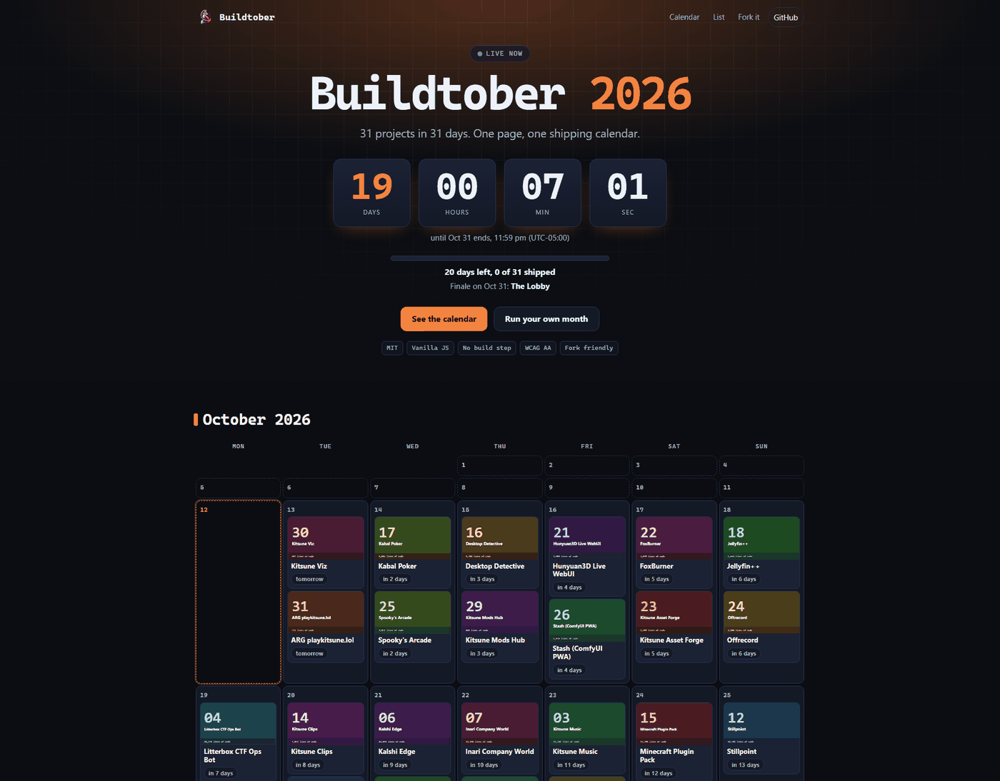

<p align="center"></p>

<h1 align="center">Buildtober</h1>

<p align="center">A one-page shipping calendar with a live countdown. Fork it, edit one JSON file, run your own month.</p>

<p align="center">
<a href="LICENSE"></a>
<a href="https://kitsunetech1.github.io/buildtober-site/"></a>
<a href="https://github.com/KitsuneTech1/buildtober-site/stargazers"></a>
<a href="https://github.com/KitsuneTech1/buildtober-site/commits/main"></a>

<a href="CONTRIBUTING.md"></a>
</p>

## What it is

Buildtober is the page I use to ship 31 projects in 31 days. It shows a countdown, a calendar with one card per ship, and a list of every project.

The page has no build step and no dependencies. It is `index.html`, `style.css`, `app.js` and one data file, `days.json`. Everything on the page comes from that file: the title, the dates, the owner, the footer links and every ship. Any month works, and so does any number of days.



## Live

https://kitsunetech1.github.io/buildtober-site/

## Use it yourself

Two ways to set it up. Pick one.

### Normal install

1. Fork this repo. Click Fork on GitHub, or run `gh repo fork KitsuneTech1/buildtober-site --clone`.
2. Edit `days.json`. Set `title`, `start`, `end`, `owner`, `github_url` and your list of `days`. See the data format below.
3. Run `node tools/sync.mjs`. It writes a placeholder card for each ship and refreshes `days.js`. Skip it if you draw your own cards.
4. Enable Pages. Settings, Pages, deploy from branch `main`, folder `/ (root)`.
5. Your site is at `https://YOU.github.io/REPO/`.

To preview locally, run `python -m http.server` in the folder and open `http://localhost:8000`. Opening `index.html` straight from disk also works, because `days.js` mirrors `days.json`.

### AI agent setup

Paste this into Claude Code, Codex or Cursor. You need the GitHub CLI logged in (`gh auth status`) and Node.

```text
You are setting up my own copy of the Buildtober shipping-calendar site. Work in a new empty folder. Do not touch any repo that is not the new fork.

GOAL
A public GitHub Pages site where each day of a date range has one or more of my projects, with a countdown. Template: https://github.com/KitsuneTech1/buildtober-site

STEPS
1. Check tools. Run `gh auth status` and `node --version`. If gh is not logged in, stop and tell me to run `gh auth login`. Do not ask me for a token.
2. Ask me these questions in ONE message and wait for the answers:
   a. Site title (example: "Shipmas 2026")
   b. Start date and end date (YYYY-MM-DD), and my UTC offset (example: -05:00)
   c. My name, my org or company (optional), and my website URL (optional)
   d. My project list: for each project give name, a one-line pitch, and the day it ships. A pasted list is fine. If a day has no project, leave it empty.
   e. Repo name for the fork (default: buildtober-site)
   f. Optional custom domain
3. Fork and clone: `gh repo fork KitsuneTech1/buildtober-site --clone --fork-name REPO` then cd into it.
4. Remove the template author's content: delete the `hold/` and `data/` folders, delete every file in `img/` except `kitsune-logo-96.png`, `kitsune-logo-192.png` and `screenshot.png`, and replace the README.md body with a short description of my site.
5. Rewrite `days.json` completely. Top-level keys: title, tagline, owner {name, org, url, github}, github_url (my fork URL), start, end, timezone_offset, finale_slug (optional), calendar_note (optional), days. Each day needs: slot (1..N, unique), name, pitch, day (YYYY-MM-DD inside start..end), status ("upcoming" or "shipped"), url ("" until it ships), slug (lowercase-with-dashes), image ("img/SLUG.svg"), hue (0-359). Keep JSON valid and UTF-8. No em dashes in any text you write.
6. Run `node tools/sync.mjs`. It writes days.js and a placeholder card for every slug.
7. Open index.html and check it with a headless check only. Do not open a browser window. If you have no headless tool, run `node -e "JSON.parse(require('fs').readFileSync('days.json','utf8'))"` and confirm every `day` is inside start..end.
8. Commit with a clear message and push to the default branch.
9. Enable Pages: `gh api -X POST repos/OWNER/REPO/pages -f "source[branch]=main" -f "source[path]=/"` (OWNER from `gh api user --jq .login`). If it says Pages already exists, that is fine.
10. If I gave a domain: write it to a file named `CNAME` at the repo root, commit, push, then run `gh api -X PUT repos/OWNER/REPO/pages -f cname=DOMAIN`. Print the DNS records I must add (A 185.199.108.153, .109.153, .110.153, .111.153; AAAA 2606:50c0:8000::153 through 8003::153; CNAME www to OWNER.github.io).
11. Wait for the build: poll `gh api repos/OWNER/REPO/pages/builds/latest --jq .status` every 5 seconds until it says "built".
12. Report: the live URL (https://OWNER.github.io/REPO/ or my domain), the repo URL, the number of days filled, and anything you could not do.

RULES
Never print or store secrets. Never open a GUI or a browser window. Do not delete anything outside this folder. If a step fails, say which step and why, then stop.
```

## Data format

`days.json` is one object. These keys sit at the top level.

| Key | Type | Required | Meaning |
| --- | --- | --- | --- |
| `title` | string | yes | Page title. A trailing 4-digit year gets the accent color. |
| `tagline` | string | no | One line under the title. |
| `owner` | object | no | `name`, `org`, `url`, `github`. Used in the footer. |
| `github_url` | string | yes | Repo URL. Used for the Source and fork links. |
| `start` | string | yes | First day, `YYYY-MM-DD`. |
| `end` | string | yes | Last day, `YYYY-MM-DD`. The calendar draws every month between start and end. |
| `timezone_offset` | string | yes | UTC offset like `-05:00`. Sets when a day starts and the countdown ends. |
| `finale_slug` | string | no | The `slug` of the last big ship. Defaults to the last day in the list. |
| `calendar_note` | string | no | A short note shown above the calendar. |
| `days` | array | yes | The ships, below. |

Each item in `days`:

| Key | Type | Meaning |
| --- | --- | --- |
| `slot` | number | Unique number, 1 to N. |
| `name` | string | Project name. |
| `pitch` | string | One line about it. |
| `day` | string | Ship date, `YYYY-MM-DD`, inside start and end. Several ships can share a day. |
| `status` | string | `upcoming` or `shipped`. |
| `url` | string | Link to the project. Empty until it ships. |
| `slug` | string | Lowercase name with dashes. Names the card image. |
| `image` | string | Card image path, for example `img/my-app.svg`. |
| `hue` | number | 0 to 359. Color of the card and its list stripe. |
| `number` | string | Optional stat line, for example `2,000 lines of code`. |

After you edit `days.json`, run `node tools/sync.mjs` so `days.js` stays in step.

## Custom domain

1. Put your domain in a file named `CNAME` at the repo root. Example: `buildtober.example.com`.
2. Add these records at your DNS host.

| Type | Name | Value |
| --- | --- | --- |
| A | `@` | `185.199.108.153`, `185.199.109.153`, `185.199.110.153`, `185.199.111.153` |
| AAAA | `@` | `2606:50c0:8000::153`, `2606:50c0:8001::153`, `2606:50c0:8002::153`, `2606:50c0:8003::153` |
| CNAME | `www` | `YOUR-USER.github.io` |

3. In Settings, Pages, enter the domain and tick Enforce HTTPS once the certificate is ready.

For a subdomain such as `ship.example.com`, skip the A and AAAA rows and add one CNAME from `ship` to `YOUR-USER.github.io`.

## Credits

Built by Moo at [Kitsune Technologies](https://kitsunetechnologies.org). Source on [GitHub](https://github.com/KitsuneTech1). Licensed under the [MIT license](LICENSE). Pull requests are welcome, see [CONTRIBUTING.md](CONTRIBUTING.md).
